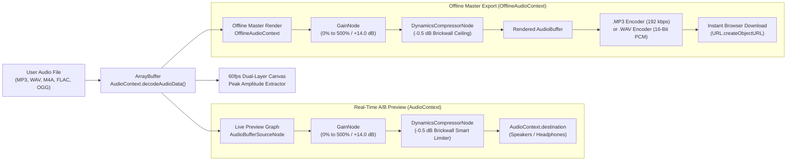

# IncreaseVolume — Increase Audio Volume Online (100% Client-Side)

[](https://increasevolume.github.io/)
[](https://astro.build/)
[](https://react.dev/)
[](https://increasevolume.github.io/)
[](./LICENSE)
[](https://ko-fi.com/kishara)

**IncreaseVolume** ([https://increasevolume.github.io/](https://increasevolume.github.io/)) is an ultra-minimal, 100% client-side web utility built with **Astro** and **React Islands**. It amplifies quiet **MP3, WAV, M4A, FLAC, and OGG** audio files up to **500% (+14.0 dB)** directly inside the browser using the HTML5 **Web Audio API** (`AudioContext`, `OfflineAudioContext`, `GainNode`, and `DynamicsCompressorNode`) with instant `.MP3` (192 kbps via `@breezystack/lamejs`) and lossless `.WAV` (16-bit PCM) export.

---

## Key Features

- **100% Client-Side Privacy (Zero Server Uploads):** Audio files never leave the user's device. Decoding, real-time previewing, dynamic limiting, and MP3/WAV encoding run entirely in browser memory.
- **Up to 500% (+14.0 dB) Volume Boost:** Includes an oversized accessible slider (`0%` to `500%`) plus 4 one-click studio presets (`150% Gentle`, `200% Double`, `300% Podcast/Voice`, `500% Max Boost`).
- **Smart Anti-Clipping Peak Limiter:** Chains a Web Audio `GainNode` into a fast-attack brickwall `DynamicsCompressorNode` (`-0.5 dB` ceiling, `20:1` ratio) so quiet dialogue and music lift dramatically without harsh digital clipping.
- **60fps Dual-Layer Waveform Visualizer:** Real-time HTML5 Canvas visualizer with spring physics (`cubic-bezier(0.22, 1, 0.36, 1)`) comparing the boosted `#B7D894` waveform against the original `#36415A` baseline, complete with live **A/B Original vs. Boosted** comparison toggle.
- **Oversized, Ultra-Accessible Ergonomics:** High-contrast WCAG AAA typography, `56px+` touch targets, full ARIA attributes (`aria-valuemin`, `aria-valuemax`, `aria-valuenow`, `aria-live="polite"`), and a responsive mobile navbar that strictly collapses to large icon-only buttons (`< 768px`).
- **Installable Offline PWA:** Full Progressive Web App (`manifest.webmanifest` + Workbox Service Worker) supporting **"Add to Home Screen"** on iOS, Android, Windows, macOS, and Linux.
- **8-Language Localization & 100/100 Technical SEO:** Static subpath routing across 8 languages with complete `hreflang` clusters, XML sitemaps, Open Graph / Twitter Cards, and strict JSON-LD `@graph` (`WebApplication`, `BreadcrumbList`, `HowTo`, `FAQPage`).

---

## Web Audio API Signal Processing Architecture



---

## Studio Design System & Color Palette

| Token Name | Hex Code | Tailwind Class | Usage Role |
| :--- | :--- | :--- | :--- |
| **Deep Midnight Navy** | `#202734` | `midnight-navy` | Dark mode primary background, light mode primary typography, structural borders, primary CTA buttons |
| **Slate Navy Surface** | `#36415A` | `slate-navy` | Dark mode elevated workspace cards, secondary labels, 100% baseline waveform layer |
| **Electric Sage Lime** | `#B7D894` | `sage-lime` | Boosted waveform amplitude bars, active slider track & thumb, active preset badges, dark mode primary CTAs |
| **Soft Mint Cream** | `#E0F8C7` | `mint-cream` | Dark mode primary typography (WCAG AAA contrast), light mode elevated cards & trust pills |
| **Mint-Tinted Alabaster** | `#F6FBF2` | `mint-alabaster` | Light mode default studio background |

---

## 8-Language Localization (i18n)

| Code | Badge | Language | Static Route | Full URL |
| :--- | :---: | :--- | :--- | :--- |
| `en` | `US` | English | `/` | `https://increasevolume.github.io/` |
| `es` | `ES` | Español | `/es/` | `https://increasevolume.github.io/es/` |
| `pt` | `BR` | Português | `/pt/` | `https://increasevolume.github.io/pt/` |
| `de` | `DE` | Deutsch | `/de/` | `https://increasevolume.github.io/de/` |
| `fr` | `FR` | Français | `/fr/` | `https://increasevolume.github.io/fr/` |
| `ja` | `JP` | 日本語 | `/ja/` | `https://increasevolume.github.io/ja/` |
| `zh` | `CN` | 简体中文 | `/zh/` | `https://increasevolume.github.io/zh/` |
| `ru` | `RU` | Русский | `/ru/` | `https://increasevolume.github.io/ru/` |

---

## Local Development Commands

### Prerequisites
- **Node.js** `>= 18.x` (tested with Node `v24.x`)
- **npm** `>= 9.x`

### Install & Run

```bash
# 1. Install dependencies
npm install

# 2. Start local development server (http://localhost:4321)
npm run dev

# 3. Build production static site + XML Sitemap + PWA Service Worker into ./dist
npm run build

# 4. Preview production build locally
npm run preview
```

---

## GitHub Pages Deployment Instructions

This repository is pre-configured for zero-config deployment to **GitHub Pages** (`https://increasevolume.github.io/`):

1. Push your code to the `main` (or `master`) branch on GitHub.
2. In your GitHub repository, navigate to **Settings → Pages**.
3. Under **Build and deployment → Source**, select **GitHub Actions**.
4. The workflow in [`.github/workflows/deploy.yml`](./.github/workflows/deploy.yml) automatically builds the Astro static output (`dist/`), includes [`public/.nojekyll`](./public/.nojekyll) so `_astro/` hashed bundles are served cleanly, and deploys to `https://increasevolume.github.io/`.

---

## Support the Developer

If **IncreaseVolume** saved your quiet audio recording, lecture, or podcast, consider supporting continued open-source development:

- **Ko-fi:** [https://ko-fi.com/kishara](https://ko-fi.com/kishara)

---

## License

Released under the [MIT License](./LICENSE). Copyright © 2026 increasevolume.
