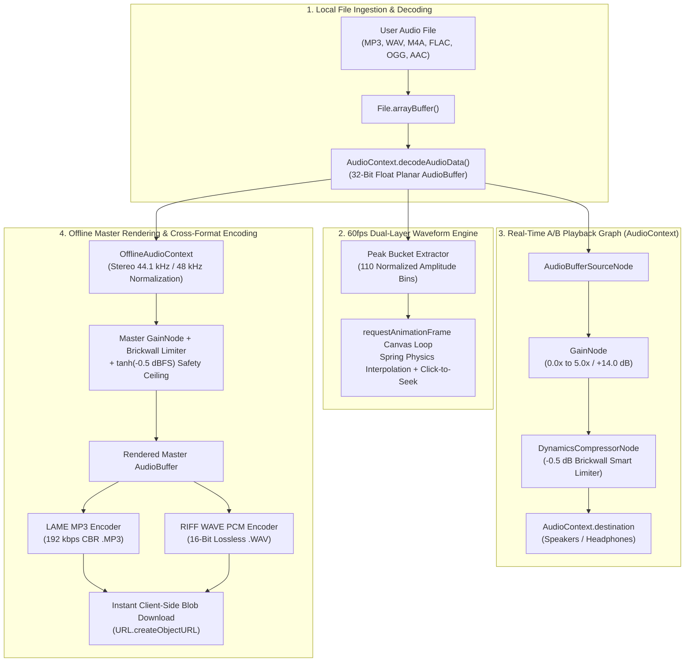

<div align="center">


# IncreaseVolume (`increasevolume.github.io`)

### **Free Online Audio & MP3 Volume Booster — 100% Client-Side Web Audio Studio**

Amplify quiet **MP3, WAV, M4A, FLAC, OGG, and AAC** recordings up to **500% (+14.0 dB)** directly inside your browser with zero server uploads, real-time 60fps dual-layer waveform visualization, a brickwall **-0.5 dB Smart Anti-Clipping Limiter**, and instant cross-format **.MP3 / .WAV** export.

[](https://increasevolume.github.io/)
[](https://astro.build/)
[](https://react.dev/)
[](https://developer.mozilla.org/en-US/docs/Web/API/Web_Audio_API)
[](https://increasevolume.github.io/)
[](./LICENSE)
[](https://ko-fi.com/kishara)

[**Launch Live Studio**](https://increasevolume.github.io/) · [**Report a Bug**](https://github.com/increasevolume/increasevolume.github.io/issues) · [**Request a Feature**](https://github.com/increasevolume/increasevolume.github.io/issues) · [**Support on Ko-fi**](https://ko-fi.com/kishara)

</div>

---

## Table of Contents

1. [Overview & Philosophy](#-overview--philosophy)
2. [Key Studio Capabilities](#-key-studio-capabilities)
3. [Web Audio API DSP Signal Flow](#-web-audio-api-dsp-signal-flow)
4. [Gain & Decibel (dB) Mastering Reference](#-gain--decibel-db-mastering-reference)
5. [Design System & Color Architecture](#-design-system--color-architecture)
6. [8-Language Internationalization (i18n)](#-8-language-internationalization-i18n)
7. [Technical SEO & Accessibility Architecture](#-technical-seo--accessibility-architecture)
8. [Project Structure](#-project-structure)
9. [Local Development & Build Guide](#-local-development--build-guide)
10. [GitHub Pages CI/CD Deployment](#-github-pages-cicd-deployment)
11. [Browser & Platform Compatibility](#-browser--platform-compatibility)
12. [Supporting the Project](#-supporting-the-project)
13. [License](#-license)

---

## Overview & Philosophy

Most online volume boosters require users to upload sensitive voice memos, lectures, interviews, or music tracks to remote cloud servers, wait in a queue, and download a heavily re-compressed file that clips and crackles on loud peaks.

**IncreaseVolume** solves this by bringing a mastering-grade audio amplification chain directly into the browser using **Astro Islands Architecture** and the native **HTML5 Web Audio API**:

- **Zero Cloud Uploads (100% Local Privacy):** Every byte of audio is decoded, previewed, dynamically limited, and encoded strictly inside your device's local RAM and CPU.
- **Zero Digital Clipping:** A studio-calibrated `DynamicsCompressorNode` (`-0.5 dB` brickwall ceiling, `20:1` ratio, `1ms` attack) protects audio peaks when boosting quiet speech up to `500% (+14.0 dB)`.
- **Full Cross-Format Transcoding:** Upload a `.WAV` file and export as `.MP3` (192 kbps CBR), or upload an `.MP3`/`.M4A`/`.FLAC`/`.OGG` file and export as lossless 16-bit PCM `.WAV`.

---

## Key Studio Capabilities

| Domain | Feature | Technical Implementation |
| :--- | :--- | :--- |
| **DSP Audio Engine** | **0% – 500% (+14.0 dB) Amplification** | High-precision `GainNode` with smooth exponential parameter ramping (`setTargetAtTime`) |
| **Anti-Clipping Protection** | **Smart Peak Limiter (-0.5 dB Ceiling)** | `DynamicsCompressorNode` (`threshold: -0.5 dB`, `knee: 0 dB`, `ratio: 20:1`, `attack: 0.001s`, `release: 0.08s`) + soft-knee hyperbolic tangent safety clamp |
| **Visual Feedback** | **60fps Dual-Layer Waveform Canvas** | Hardware-accelerated HTML5 `<canvas>` with spring interpolation (`cubic-bezier(0.22, 1, 0.36, 1)`) comparing original (`#36415A`) vs. boosted (`#B7D894`) amplitude |
| **Live Auditioning** | **Instant A/B Bypass Switch** | Seamless real-time toggle between **Original (100% / 0.0 dB)** and **Boosted Master** during active playback |
| **Cross-Format Export** | **.MP3 (192 kbps) & .WAV (16-Bit PCM)** | `OfflineAudioContext` stereo resampling (`44.1 kHz` / `48 kHz`) paired with in-browser LAME MP3 encoder (`src/lib/lamejs.js`) & RIFF WAVE PCM encoder |
| **Ergonomics & UI** | **Oversized Studio Controls** | `56px+` touch targets, `34px` range slider thumb, one-click presets (`150% Gentle`, `200% Double`, `300% Voice`, `500% Max`), and collapsible mobile/tablet navigation drawer |
| **Offline PWA** | **Installable Desktop & Mobile App** | `@vite-pwa/astro` + Workbox Service Worker precaching all assets for 100% offline execution |

---

## Web Audio API DSP Signal Flow



---

## Gain & Decibel (dB) Mastering Reference

The decibel readout is computed in real time from the linear amplitude multiplier $G = \frac{\text{Percent}}{100}$ via:

$$\text{dB} = 20 \cdot \log_{10}\left(\frac{\text{Percent}}{100}\right)$$

| Studio Preset | Percentage | Linear Gain ($G$) | Decibel Gain ($\text{dB}$) | Recommended Use Case |
| :--- | :---: | :---: | :---: | :--- |
| **Mute** | `0%` | `0.00x` | $-\infty\text{ dB}$ | Complete silence |
| **Original Baseline** | `100%` | `1.00x` | `0.0 dB` | Unity gain (unmodified original level for A/B comparison) |
| **Gentle** | `150%` | `1.50x` | `+3.5 dB` | Subtle mastering lift for slightly quiet music tracks |
| **Double (Default)** | `200%` | `2.00x` | `+6.0 dB` | Doubles waveform amplitude; ideal for everyday MP3 & video audio |
| **Voice** | `300%` | `3.00x` | `+9.5 dB` | Optimized for quiet podcasts, interviews, meetings, and voice memos |
| **Max** | `500%` | `5.00x` | `+14.0 dB` | Maximum rescue amplification for distant microphone or lecture recordings |

---

## Design System & Color Architecture

IncreaseVolume uses an ultra-high-contrast studio palette engineered to meet **WCAG AAA** readability standards across both **Light Mode** (default) and **Dark Mode**:

| Color Token | Hex Code | Tailwind Class | Light Mode Role | Dark Mode Role |
| :--- | :---: | :--- | :--- | :--- |
| **Deep Midnight Navy** | `#202734` | `midnight-navy` | Primary typography, structural borders, primary CTA buttons | Primary page background, active button text |
| **Slate Navy Surface** | `#36415A` | `slate-navy` | Secondary body copy, 100% baseline waveform bars | Elevated studio cards, control surfaces |
| **Electric Sage Lime** | `#B7D894` | `sage-lime` | Active slider track/thumb, boosted waveform bars, active presets | Primary CTA buttons, boosted waveform bars, focus rings |
| **Soft Mint Cream** | `#E0F8C7` | `mint-cream` | Elevated feature cards, trust badges, CTA button text | Primary headings & high-contrast typography |
| **Mint-Tinted Alabaster** | `#F6FBF2` | `mint-alabaster` | Clean, low-glare studio page background | — |

---

## 8-Language Internationalization (i18n)

All UI controls, presets, live status announcements, step-by-step guides, technical deep-dives, FAQs, and SEO metadata tags are statically generated across **8 languages** via [src/i18n/translations.ts](./src/i18n/translations.ts):

| Locale Code | Badge | Language | Static Route | Canonical Production URL |
| :---: | :---: | :--- | :---: | :--- |
| `en` | `US` | **English** (Default) | `/` | `https://increasevolume.github.io/` |
| `es` | `ES` | **Español** | `/es/` | `https://increasevolume.github.io/es/` |
| `pt` | `BR` | **Português** | `/pt/` | `https://increasevolume.github.io/pt/` |
| `de` | `DE` | **Deutsch** | `/de/` | `https://increasevolume.github.io/de/` |
| `fr` | `FR` | **Français** | `/fr/` | `https://increasevolume.github.io/fr/` |
| `ja` | `JP` | **日本語** | `/ja/` | `https://increasevolume.github.io/ja/` |
| `zh` | `CN` | **简体中文** | `/zh/` | `https://increasevolume.github.io/zh/` |
| `ru` | `RU` | **Русский** | `/ru/` | `https://increasevolume.github.io/ru/` |

---

## Technical SEO & Accessibility Architecture

- **100/100 Metadata & Open Graph:** Localized `<title>`, `<meta name="description">`, `<meta name="keywords">`, Open Graph (`og:title`, `og:description`, `og:image`, `og:url`, `og:locale`), and Twitter Card (`summary_large_image`) tags.
- **Bidirectional `hreflang` Cluster & XML Sitemap:** Every page links to all 8 localized variants plus `x-default`, matched 1:1 in `sitemap-index.xml` and `sitemap-0.xml`.
- **Strict JSON-LD `@graph` Structured Data:** Includes `WebApplication`, `BreadcrumbList`, `HowTo`, and `FAQPage` schemas in [src/layouts/Layout.astro](./src/layouts/Layout.astro) with **zero fabricated review or rating schemas**.
- **Full WAI-ARIA & Keyboard Support:** Explicit `aria-label`, `aria-valuemin="0"`, `aria-valuemax="500"`, `aria-valuenow`, and `aria-valuetext` on the range slider; `role="switch"` and `aria-checked` on the Smart Limiter; and `aria-live="polite"` regions announcing gain and export progress to screen readers.

---

## Project Structure

```text
increasevolume.github.io/
├── .github/
│   └── workflows/
│       └── deploy.yml                  # Official Astro GitHub Pages CI/CD workflow
├── public/
│   ├── .nojekyll                       # Ensures GitHub Pages serves _astro/* assets
│   ├── favicon.svg                     # Vector app icon & PWA maskable icon
│   ├── og-image.svg                    # 1200x630 Open Graph social preview card
│   ├── robots.txt                      # Search crawler directives + Sitemap pointer
│   └── sw.js                           # Dev cache-cleaner (replaced by Workbox in build)
├── src/
│   ├── components/
│   │   ├── AudioBoosterIsland.tsx      # Interactive Web Audio API React Island
│   │   ├── BoosterLandingPage.astro    # Main page template, HowTo, Features, FAQ & Footer
│   │   └── Navbar.astro                # Responsive Navbar + Mobile/Tablet Drawer + PWA Modal
│   ├── i18n/
│   │   └── translations.ts             # Complete 8-language localized dictionary
│   ├── layouts/
│   │   └── Layout.astro                # HTML head, GA4 (G-FGJCVGP26V), SEO, JSON-LD, Theme
│   ├── lib/
│   │   ├── lamejs.js                   # Self-contained ES module MP3 encoder
│   │   └── lamejs.d.ts                 # TypeScript declarations for Mp3Encoder
│   ├── pages/
│   │   ├── index.astro                 # English root route (/)
│   │   └── [lang]/
│   │       └── index.astro             # Localized static routes (/es/, /pt/, /de/, etc.)
│   └── env.d.ts                        # Astro & Vite PWA TypeScript environment references
├── astro.config.mjs                    # Astro + React + Tailwind + Sitemap + VitePWA config
├── tailwind.config.mjs                 # Custom studio color tokens & spring physics config
├── tsconfig.json                       # Strict TypeScript configuration
├── package.json                        # Scripts & dependencies
├── LICENSE                             # MIT License
└── README.md                           # Project documentation
```

---

## Local Development & Build Guide

### Prerequisites

- **Node.js** `>= 18.17.0` (tested on Node `v24.x`)
- **npm** `>= 9.0.0`

### Quick Start

```bash
# 1. Clone the repository
git clone https://github.com/increasevolume/increasevolume.github.io.git
cd increasevolume.github.io

# 2. Install dependencies
npm install

# 3. Start the Astro development server with HMR at http://localhost:4321
npm run dev
```

### Production Build & Verification

```bash
# Build static HTML, CSS, JS bundles, XML Sitemaps, and Workbox Service Worker into ./dist
npm run build

# Preview the production build locally
npm run preview
```

---

## GitHub Pages CI/CD Deployment

This repository includes a turnkey GitHub Actions workflow ([`.github/workflows/deploy.yml`](./.github/workflows/deploy.yml)) for automated deployment to `https://increasevolume.github.io/`:

1. Push your commits to the `main` (or `master`) branch.
2. In your GitHub repository, navigate to **Settings → Pages**.
3. Under **Build and deployment → Source**, select **GitHub Actions**.
4. GitHub Actions will automatically run `withastro/action@v3`, build the static site and sitemap into `./dist`, and publish to GitHub Pages.

---

## Browser & Platform Compatibility

| Browser / Platform | Web Audio API (`AudioContext` + `OfflineAudioContext`) | 60fps Canvas Waveform | MP3 & WAV Export | Offline PWA Install |
| :--- | :---: | :---: | :---: | :---: |
| **Google Chrome / Edge (Desktop & Android)** | ✅ Supported | ✅ Supported | ✅ Supported | ✅ Native Prompt |
| **Apple Safari (macOS & iOS / iPadOS)** | ✅ Supported | ✅ Supported | ✅ Supported | ✅ Share → Add to Home Screen |
| **Mozilla Firefox (Desktop & Android)** | ✅ Supported | ✅ Supported | ✅ Supported | ✅ Supported |
| **Brave / Opera / Samsung Internet** | ✅ Supported | ✅ Supported | ✅ Supported | ✅ Supported |

---

## Supporting the Project

**IncreaseVolume** is 100% free, ad-free, and open-source. If this tool helped you rescue a quiet recording, lecture, or podcast, you can support ongoing development on Ko-fi:

<div align="center">

[](https://ko-fi.com/kishara)

</div>

---

## License

Distributed under the **MIT License**. See [LICENSE](./LICENSE) for full license text.

Copyright © 2026 **IncreaseVolume** ([increasevolume.github.io](https://increasevolume.github.io/)).
